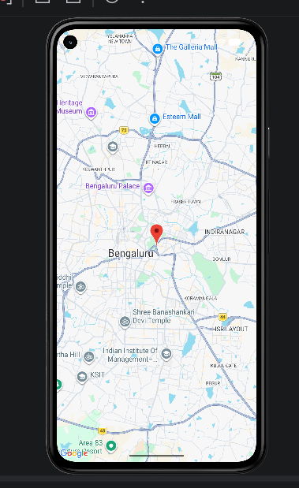

# GoogleMapsApp – Android Studio Experiment

 

## 1. Aim

To develop an Android application using Android Studio that integrates Google Maps to display geographical locations on a mobile device.

 

## 2. Description

GoogleMapsApp is an Android application developed using Android Studio. It demonstrates the integration of Google Maps into a mobile application using the Google Maps API.

 

The application displays a map interface, helping users visualize geographical locations. This experiment introduces the basic concepts of map integration and location-based mobile application development.

 

## 3. Concepts and Technologies Used

 

- **Android Studio:** Integrated development environment used to develop Android applications.

- **Google Maps API:** Used to integrate Google Maps into the application.

- **Kotlin/Java:** Used to implement the application logic.

- **XML:** Used to design the application layout, if applicable.

- **Gradle:** Used to manage project dependencies and build the application.

- **Android Emulator:** Used to run and test the application.

 

## 4. Scenario

 

**Scenario: Displaying Google Maps in a Mobile Application**

 

Consider a user who wants to view a geographical map using an Android application. GoogleMapsApp demonstrates how Google Maps can be integrated into a mobile application.

 

When the user launches the application, the map interface is displayed on the screen. This demonstrates how mapping services can be used in mobile applications for geographical visualization and location-based services.

 

## 5. Features

 

- Integration of Google Maps into an Android application.

- Display of a map interface.

- Demonstration of Google Maps API integration.

- Android application development using Android Studio.

- Testing using an Android Emulator or Android device.

 

## 6. Software Requirements

 

| Component | Technology |

|---|---|

| IDE | Android Studio |

| Programming Language | Kotlin or Java |

| Map Service | Google Maps API |

| Build Tool | Gradle |

| Testing Platform | Android Emulator or Android Device |

 

## 7. Project Folder Structure

 

```text

GoogleMapsApp/

├── app/

│   ├── src/

│   │   └── main/

│   │       ├── java/

│   │       │   └── MapsActivity.kt

│   │       ├── res/

│   │       │   ├── layout/

│   │       │   └── values/

│   │       └── AndroidManifest.xml

│   └── build.gradle.kts

├── gradle/

│   └── wrapper/

├── Screenshot/

│   └── Output.png

├── build.gradle.kts

├── settings.gradle.kts

├── gradle.properties

├── gradlew

├── gradlew.bat

└── README.md

```

 

**Note:** The folder structure is illustrative. Actual filenames and folders may differ depending on your project configuration.

 

## 8. Output Screenshot

 

The following screenshot demonstrates the output of the GoogleMapsApp application.

 



 

**Figure 1: GoogleMapsApp Output**

 

## 9. Learning Outcomes

 

1. Learned the basics of Android application development using Android Studio.

2. Understood the integration of Google Maps into an Android application.

3. Learned about APIs and their role in mobile application development.

4. Understood Android project structure and configuration.

5. Learned how to build and test an Android application using an emulator.

 

## 10. Result

 

Thus, the GoogleMapsApp Android application was developed to demonstrate Google Maps integration in Android Studio. The experiment provides an understanding of map-based functionality and its applications in mobile development.
